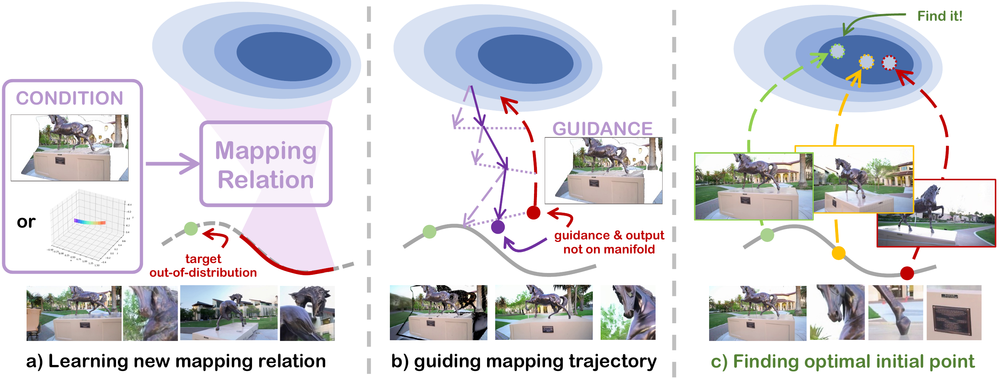

# NeoMap: Training-free Novel-View Synthesis from Single Images and Videos (ECCV 2026)

<h4 align="center">

[](./LICENSE)
[](https://arxiv.org/abs/2607.01962)
[](https://github.com/vLAR-group/NeoMap)

<p>
    
</p>

</h4>

This repository contains the implementation of the paper: *NeoMap: Training-free Novel-View Synthesis from Single Images and Videos*.
NeoMap is a training-free framework for novel-view video synthesis from single images or monocular videos. It locates high-fidelity, view-consistent novel-view solutions within the natural video data manifold learned by general pre-trained video models through convergent manifold alternating projection iterations.

Please feel free to contact us via [jinxi.li, tonax.zhang]@connect.polyu.hk or open an issue if you have any questions or suggestions.

**Try NeoMap on your own scene!** This guide covers the single-image / static-scene release workflow: bring one image, let VGGT estimate its geometry, and generate a novel-view video. You can also provide your own depth and camera trajectory, or use multiple images to build a scene in our interactive interface. No benchmark dataset or COLMAP folder is required for these new entry points.

<!--
## 📹 Demo

<p>
    
</p>
-->

## 📢 News

- **2026-07-02**: NeoMap is released on [arXiv](https://arxiv.org/abs/2607.01962).
- **2026-07-02**: NeoMap is accepted by ECCV 2026.

## 📋 TODO

- [x] Submit the paper onto arXiv.
- [x] Release the project repository.
- [x] Add installation and pretrained-model instructions.
- [x] Add personal-data inference and an interactive interface.
- [ ] Validate a clean environment installation and full-resolution release benchmarks.
- [ ] Release evaluation code and the complete benchmark data instructions.

## ⚙️ Installation

### 1. Create the environment

Our current smoke-tested setup is **Linux + NVIDIA H200, Python 3.11.14, PyTorch 2.4.1 with CUDA 12.1, and FlashAttention 2.7.3**. We provide [environment.yml](environment.yml) for the base environment and [requirements-release.txt](requirements-release.txt) for the runtime dependencies. Please follow the installation order below so that other packages do not select a different PyTorch build.

```bash
git clone https://github.com/vLAR-group/NeoMap.git --recursive
cd NeoMap
# If using a release directory/archive, enter that directory instead.
# For example: cd "/path/to/NeoMap release"

conda env create -f environment.yml
conda activate neomap

# Install the matching CUDA wheels first.
python -m pip install torch==2.4.1 torchvision==0.19.1 torchaudio==2.4.1 \
  --index-url https://download.pytorch.org/whl/cu121
python -m pip install -r requirements-release.txt

# Install FlashAttention after PyTorch.
# If building from source, first provide a compatible CUDA toolkit and C++ compiler.
nvcc --version
MAX_JOBS=4 python -m pip install flash-attn==2.7.3 --no-build-isolation
python -m pip check
```

The GPU driver must support the selected CUDA runtime. `nvidia-smi` reports driver capability; `torch.version.cuda` reports the PyTorch runtime; `nvcc --version` reports the build toolkit. They are not the same setting. See the official [PyTorch installation matrix](https://pytorch.org/get-started/previous-versions/) if you need another combination; only the combination above has been used in our current tests.

Key dependency groups are:

| Component | Versions used in our environment |
| --- | --- |
| Model inference | PyTorch 2.4.1, torchvision 0.19.1, FlashAttention 2.7.3 |
| Model loading / text | diffusers 0.32.0, transformers 4.51.3, accelerate 1.5.2 |
| Geometry / images | NumPy 1.26.4, SciPy 1.14.1, Pillow 11.3.0, OpenCV 4.10.0.84 |
| Video | imageio 2.36.0, imageio-ffmpeg 0.5.1 |
| Interactive interface | Gradio 5.12.0, Plotly 6.5.0 |

**Installation status:** this recipe was curated from our working environment; a clean installation has not yet been verified. It is not a full transitive lockfile. See [environment notes](docs/ENVIRONMENT.md) for the tested scope and compatibility details. The original benchmark launchers may need extra dependencies that are not part of this personal-data workflow.

### 2. Prepare VGGT and Wan

We use [VGGT](https://github.com/facebookresearch/vggt) for geometry and **Wan2.2-I2V-A14B** for generation. Please keep the NeoMap-modified Wan code in `tools/Wan/`; do not replace it with a fresh upstream Wan checkout.

```bash
# VGGT source. Skip this if you already have a compatible checkout.
git clone https://github.com/facebookresearch/vggt.git tools/vggt

# Download weights once. Skip these commands when reusing existing local weights.
hf download facebook/VGGT-1B model.pt --local-dir checkpoints/VGGT-1B
hf download Wan-AI/Wan2.2-I2V-A14B --local-dir checkpoints/Wan2.2-I2V-A14B
```

The official weights are available at [VGGT-1B](https://huggingface.co/facebook/VGGT-1B) and [Wan2.2-I2V-A14B](https://huggingface.co/Wan-AI/Wan2.2-I2V-A14B). Follow their respective licenses and access requirements. Downloading the complete Wan checkpoint requires substantial disk space and bandwidth; reuse an existing copy when possible.

**Do not install VGGT's requirements on top of this environment:** its pinned PyTorch versions can conflict with the combination above. We import VGGT from the source directory configured below. The source-import check verifies the required interfaces; a fresh upstream VGGT checkout is not yet separately qualified by our smoke tests.

```text
NeoMap/
├── checkpoints/
│   ├── VGGT-1B/
│   │   └── model.pt
│   └── Wan2.2-I2V-A14B/
│       ├── high_noise_model/
│       ├── low_noise_model/
│       ├── google/umt5-xxl/
│       ├── models_t5_umt5-xxl-enc-bf16.pth
│       └── Wan2.1_VAE.pth
├── tools/
│   ├── vggt/vggt/
│   └── Wan/                         # NeoMap's existing Wan implementation
└── configs/neomap.example.yaml
```

Edit [configs/neomap.example.yaml](configs/neomap.example.yaml) if your models are elsewhere:

```yaml
checkpoints:
  wan: ../checkpoints/Wan2.2-I2V-A14B
  vggt: ../checkpoints/VGGT-1B/model.pt
repositories:
  vggt: ../tools/vggt
```

Relative paths are resolved from the **config file's directory**. Absolute paths are also supported. The entry points default to this portable example config. For a private machine setup, copy it to `configs/neomap.local.yaml`, edit the paths, and pass that file through `--config`. Files matching `*.local.*` are ignored by Git.

### 3. Check the setup

```bash
# Select a free physical GPU; replace 0 as needed.
CUDA_VISIBLE_DEVICES=0 python scripts/check_environment.py \
  --config configs/neomap.example.yaml

# Geometry/UI checks, without loading model weights or requiring a GPU.
python scripts/check_environment.py --cpu-only
python -m unittest discover -s tests -v
```

The checker validates imports and configured paths without loading the weights. GPU inference requires more than successful imports. Start with a small test before running a full video; no minimum VRAM for consumer GPUs is currently claimed. CPU offloading is enabled by default and requires substantial host RAM. This release uses A14B, not TI2V-5B.

## 💾 Prepare Your Data

Choose the input layout that matches what you have:

```text
data/
├── my_image/                        # Automatic geometry and orbit
│   └── reference.png
├── my_scene/                        # Your own depth and camera trajectory
│   ├── reference.png
│   ├── depth.npy                    # Or a depth PNG, with --depth-scale
│   └── cameras.json
└── my_multiview_scene/              # Upload these together in the interface
    ├── image_000.png
    ├── image_001.png
    └── image_002.png
```

For single-image mode, only an RGB image is needed. For multi-image reconstruction, use overlapping views of the **same static scene**; the interface currently accepts up to 16 images. VGGT preprocessing produces its own aligned image/depth/intrinsics, which are saved in the exported bundle.

### Images, depth and cameras

For `my_scene`, provide:

- **RGB:** an image readable by Pillow, e.g. PNG or JPEG.
- **Depth:** an `H × W` floating-point `.npy`, or a single-channel depth PNG. Depth is positive **camera-Z**, not inverse depth, a colored visualization, or Euclidean distance along a ray. Zero/NaN values are treated as invalid. PNG depths are multiplied by `--depth-scale`; for millimeters to meters, use `0.001`.
- **Cameras:** a version-1 JSON file, following [examples/cameras.json](examples/cameras.json). It contains image dimensions, FPS, source intrinsics/pose, and one camera per output frame.

The camera convention is **OpenCV: X right, Y down, Z forward**, with **camera-to-world** poses (`X_world = R @ X_camera + t`). Intrinsics use pixel units, zero skew, and the standard `[[fx,0,cx],[0,fy,cy],[0,0,1]]` layout. Depth and camera translations must share the same units and scale.

RGB/depth dimensions must match `width` and `height` in the JSON. If you resize/crop your image, update both the depth and intrinsics accordingly; explicit mode does not silently align them. `target_cameras` must contain **5, 9, …, 81** entries (`4n+1` frames). The source pose can be identity when all targets are expressed in the source-camera frame.

The example JSON is a complete five-frame, 640×480 sideways trajectory with sample intrinsics and a final translation of 0.1 scene units. **Replace its calibration and poses for your actual scene**; do not copy those numbers as an estimated camera. If you do not have calibration/depth, start with single-image mode instead.

## 🔑 Usage

Run the following commands from the release root. For file paths containing spaces, use quotes.

### 1. A quick CPU test

This creates a tiny synthetic RGB/depth/camera bundle and renders its priors. No model weights or GPU are needed.

```bash
python scripts/make_synthetic.py --output-dir outputs/synthetic
python main_neomap.py explicit \
  --image outputs/synthetic/reference.png \
  --depth outputs/synthetic/depth.npy \
  --trajectory outputs/synthetic/cameras.json \
  --output-dir outputs/cpu_smoke --prepare-only
```

Inspect `outputs/cpu_smoke/prior.mp4`. This is the geometric preview, **not** a Wan-generated result. For a small actual GPU wiring test, repeat the command without `--prepare-only`, add `--config configs/neomap.example.yaml --steps 3 --projections 1 --reanchors 0 --max-area 16384`, and select a free GPU via `CUDA_VISIBLE_DEVICES`. These reduced settings test execution, not visual quality.

### 2. Start from one image

```bash
CUDA_VISIBLE_DEVICES=0 python main_neomap.py orbit \
  --image data/my_image/reference.png \
  --orbit-angle 30 --radius-scale 1 --num-frames 49 \
  --config configs/neomap.example.yaml \
  --output-dir outputs/my_image \
  --prompt "A stationary scene. The camera moves smoothly."
```

Change `--orbit-angle 30` to `60` for a larger horizontal orbit. VGGT estimates the geometry, then the camera rotates around the source optical-axis point at the median valid depth in the central image region. `--radius-scale 1` uses the initial camera-to-pivot distance. Other radius scales transition smoothly from that initial radius, preserving the first view. VGGT's scale is generally arbitrary, not a guaranteed metric distance.

For this mode, `--prepare-only` skips **Wan**, but still runs **VGGT on a GPU**.

### 3. Use your own depth and trajectory

```bash
CUDA_VISIBLE_DEVICES=0 python main_neomap.py explicit \
  --image data/my_scene/reference.png \
  --depth data/my_scene/depth.npy \
  --trajectory data/my_scene/cameras.json \
  --config configs/neomap.example.yaml \
  --output-dir outputs/my_scene
```

For a depth PNG, replace the depth path and add the appropriate `--depth-scale`. In explicit mode, frame count and FPS come from `cameras.json`; `--num-frames` applies to automatic orbit mode only. Explicit mode does not run VGGT.

### 4. Design a trajectory interactively

```bash
python app_neomap.py --config configs/neomap.example.yaml --port 7860
```

The interface binds to `127.0.0.1` only. When working on a remote server, open an SSH tunnel **on your own computer** and visit `http://127.0.0.1:7860`:

```bash
ssh -L 7860:127.0.0.1:7860 user@your-server
```

1. Upload one or more images, set a **free physical GPU index**, and click **Reconstruct with VGGT**. Launch the interface without a restrictive `CUDA_VISIBLE_DEVICES`; its worker sets the device for each job. The interface's initial GPU value is 4—change it to match your machine.
2. Choose the source image. Inspect the point cloud, adjust the orbit/translation controls, and click **Preview camera**. Black preview pixels are unobserved regions.
3. Click **Confirm / add keyframe** for each desired view. The source camera is already the first keyframe. Select 5–81 frames in `4n+1` increments; you need at least two keys and no more keys than frames. Changing the source image resets the path.
4. Click **Save camera bundle** to export the path, or **Generate** to save a snapshot and start a background task. Status/logs update in the interface. You can cancel the active task.
5. Play the completed video, or click **Load generated video with VGGT** to reconstruct up to eight evenly spaced frames and display their point cloud.

**Point-cloud dragging is for inspection only.** The sliders/numeric controls define the generation camera. Interpolation reaches each keyframe with smooth easing and stops at keys; it is not a constant-speed camera controller. The reconstructed generated cloud has its own scale/pose and is not aligned to the input cloud or ground-truth geometry.

The UI serializes its own jobs per GPU and rejects a GPU occupied by another workload; it does not stop other users' processes or automatically retry busy devices. Avoid launching an independent CLI job on the same GPU. VGGT and Wan run in separate stages/processes so their weights do not stay loaded together. Browser point-cloud display is subsampled; full scene data stays on the server.

### 5. Save and replay a scene

The interface exports a bundle under `outputs/ui/<session>/exports/<export>/`:

```text
export/
├── reference.png
├── depth.npy
├── cameras.json
├── keyframes.json
├── scene_metadata.json
└── scene.npz                        # Full scene, including multi-view geometry
```

The download button provides `cameras.json`; copy the **whole directory** if you need to move/replay the scene on another machine. To retain multi-view geometry, use `bundle` rather than reconstructing only the exported reference image:

```bash
CUDA_VISIBLE_DEVICES=0 python main_neomap.py bundle \
  --bundle "/path/to/export" \
  --config configs/neomap.example.yaml \
  --output-dir outputs/replay
```

### Parameters and outputs

| Argument | Default | Meaning |
| --- | --- | --- |
| `--num-frames` | 49 | Automatic orbit frames; explicit/bundle use the JSON length |
| `--tau` | 0.98 | Starting noise level for projection optimization |
| `--steps` | 15 | Reverse-flow steps, including the bootstrap step |
| `--projections` | 15 | AMP + PCP iterations at τ |
| `--reanchors` | 3 | Early AMP-only reanchors; must be ≤ `steps - 2` |
| `--shift` | 3.5 | Time shift for the τ→0 scheduler |
| `--max-area` | 921600 | Pixel-area budget (1280×720), not a fixed output width/height |
| `--seed` | 42 | Reproducibility seed |
| `--mask-kernel` | 3 | Odd visibility erosion kernel size |
| `--splat-radius` | 1 | Point rendering footprint; 0, 1 or 2 |
| `--prepare-only` | off | Render priors without Wan; orbit still needs VGGT |
| `--no-offload` | off | Keep more model computation on GPU; increases VRAM demand |

The implementation first denoises pure noise **1→τ**, applies the fixed-τ projection iterations, and then uses a fresh time-shifted scheduler for **τ→0**. Strict VAE-block visibility masking remains enabled. This masks compression blocks, not the encoder's entire receptive field.

For CLI runs, the output directory contains `inputs/`, `prior.mp4`, `visibility_stats.json`, and `run.json`; successful Wan generation adds `final_prompt.txt` and `output.mp4`. The UI also keeps per-job logs. `output/` and `outputs/` directories are ignored by Git. On a bandwidth-limited server, check logs and small previews first instead of repeatedly downloading videos or point clouds.

## 🛠️ Troubleshooting and Current Scope

- **CUDA / FlashAttention import errors:** check the active environment and the PyTorch/CUDA/FlashAttention pairing. Rebuild FlashAttention after changing PyTorch; do not mix arbitrary binary wheels.
- **Missing checkpoints / tokenizer:** use `scripts/check_environment.py --config ...` and ensure the complete Wan directory, including `google/umt5-xxl`, is present. Our VGGT wrapper expects `model.pt`.
- **Image/depth size mismatch or distorted motion:** verify resolution, intrinsics, camera-to-world convention, depth type, and shared scale. Start from `--prepare-only` before loading Wan.
- **Out of memory:** choose a free GPU, reduce frames/pixel area, keep default offloading, and use fewer input/review images. We have not validated a universal minimum VRAM.
- **Cannot open the UI:** keep the server process running and verify the SSH tunnel/port. Do not expose this unauthenticated research interface publicly.
- **Quality expectations:** the current tests cover CPU geometry/UI callbacks and small GPU inference/reconstruction. Full-resolution 49/81-frame release quality is not yet benchmarked. Multi-view fusion uses a basic z-buffer, and the new renderer is not pixel-identical to the legacy renderer. See [test report](docs/TEST_REPORT.md) and [implementation notes](docs/RELEASE.md).

### Original dataset entry points

We retain `main_static_wan22_inner_loop.py` as the dataset entry point, using the configuration-driven implementation, and provide [run_bash/run_dataset.example.sh](run_bash/run_dataset.example.sh) as a launcher template. This entry point keeps the dataset renderer and requires its additional geometry/COLMAP dependencies. Personal launch scripts and obsolete experimental implementations are excluded from the public release.

<!--
TODO: When releasing the complete datasets used in our experiments, document
their directory structure, extra dependencies, camera/depth preparation, per-scene
commands derived from run_bash/run_dataset.example.sh, and main-file arguments here. Preserve these
entry points so users can reproduce the complete-data experiments directly.
Do not treat the new personal-data environment as validated for all legacy scripts.
-->

Complete benchmark data and reproduction instructions will be added in a later release. For now, please follow the pipeline above to use your own data.

### Example scripts and private files

[scripts/run_orbit.example.sh](scripts/run_orbit.example.sh) accepts an image path,
an optional config, and an optional output directory. It does not contain a
specific machine's paths:

```bash
GPU=0 bash scripts/run_orbit.example.sh data/my_image/reference.png
```

Use `configs/neomap.local.yaml`, `scripts/private/`, or files named `*.local.sh`
for your own model/data paths. These locations, downloaded checkpoints, external
VGGT source, datasets, outputs and caches are ignored by Git. Author names in the
paper citation/contact information remain public metadata.

## 😊 Acknowledgement

We thank the authors of [FlexWorld](https://github.com/ML-GSAI/FlexWorld), [Wan2.2](https://github.com/Wan-Video/Wan2.2), [VGGT](https://github.com/facebookresearch/vggt), [Video Depth Anything](https://github.com/DepthAnything/Video-Depth-Anything), and [VIPE](https://github.com/nv-tlabs/vipe) for their open-source code and excellent work.

## 📚 Citation

If you find our work helpful, please consider citing:

```bibtex
@article{li2026neomap,
  title={NeoMap: Training-free Novel-View Synthesis from Single Images and Videos},
  author={Jinxi Li and Tianyi Zhang and Yafei Yang and Zihui Zhang and Peng Huang and Koon Wing Macgyver Lin and Bo Yang},
  journal={ECCV},
  year={2026}
}
```
